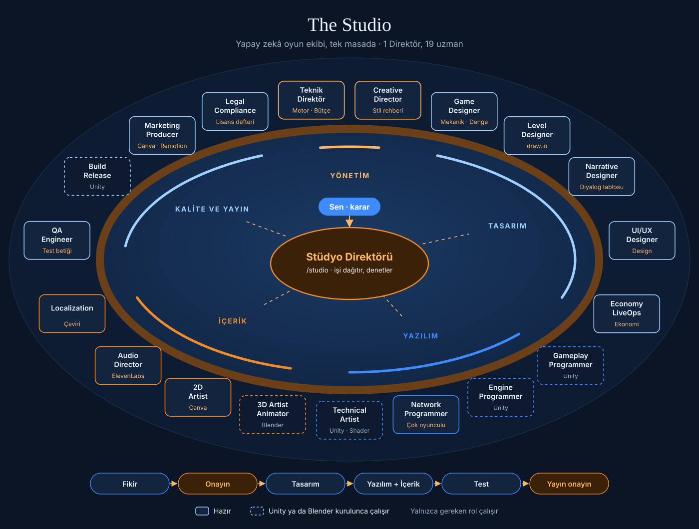
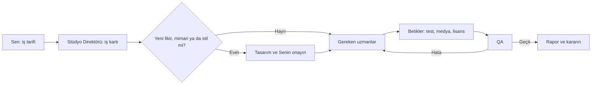
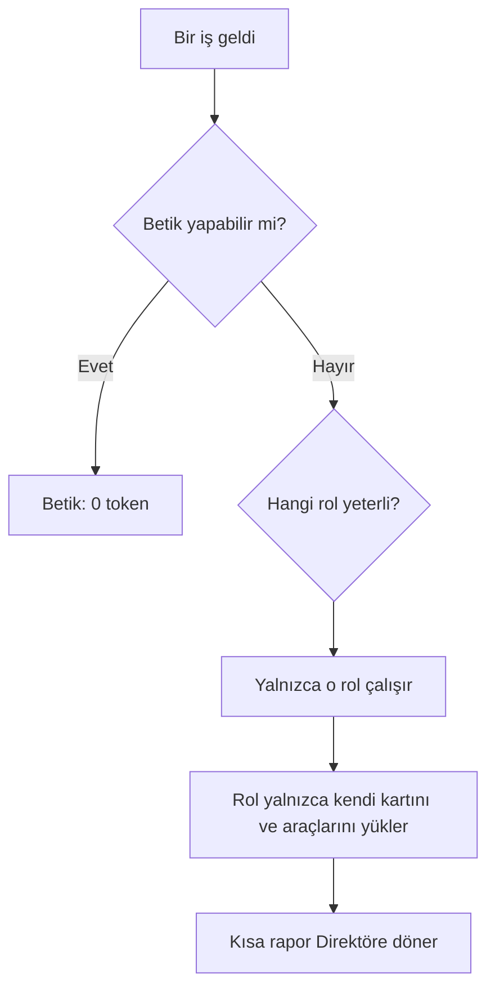

# The Studio

**Claude Code için 20 kişilik yapay zekâ oyun stüdyosu.** Tasarım, yazılım, 3B, 2B, ses, test ve yayın hazırlığı tek masada; kararlar sende.

  

Bir iş tarif edersin; Stüdyo Direktörü yalnızca o işe gereken uzmanları çağırır, iş kartı açar, sonuçları denetler ve kararı sana getirir. Rutin işleri token harcamayan betikler yapar, para harcayan her üretim önce onayından geçer.

## Tek bakışta

| | |
|---|---|
| **Ekip** | 1 Stüdyo Direktörü, 19 uzman, 5 bölüm |
| **Motorlar** | Unity, Godot, Unreal, web |
| **Üretim araçları** | Blender, Canva, ElevenLabs, Remotion, draw.io |
| **Boştayken yük** | Oturum başına yaklaşık 900 token |
| **Rutin işler** | 6 betik, 0 token |
| **Son söz** | Her zaman sende: fikir, mimari, kredi harcaması, yayın |

## Ekip

| Bölüm | Kişi | Roller |
|---|---|---|
| **Yönetim** | 3 | [Stüdyo Direktörü](docs/agents.md#studio-director) · [Teknik Direktör](docs/agents.md#technical-director) · [Creative Director](docs/agents.md#creative-director) |
| **Tasarım** | 5 | [Game Designer](docs/agents.md#game-designer) · [Level Designer](docs/agents.md#level-designer) · [Narrative Designer](docs/agents.md#narrative-designer) · [UI/UX Designer](docs/agents.md#ui-ux-designer) · [Economy ve LiveOps](docs/agents.md#economy-liveops-designer) |
| **Yazılım** | 4 | [Gameplay Programmer](docs/agents.md#gameplay-programmer) · [Engine Programmer](docs/agents.md#engine-programmer) · [Network Programmer](docs/agents.md#network-programmer) · [Technical Artist](docs/agents.md#technical-artist) |
| **İçerik** | 4 | [3D Artist ve Animator](docs/agents.md#3d-artist) · [2D Artist](docs/agents.md#2d-artist) · [Audio Director](docs/agents.md#audio-director) · [Localization Specialist](docs/agents.md#localization-specialist) |
| **Kalite ve yayın** | 4 | [QA Engineer](docs/agents.md#qa-engineer) · [Build ve Release](docs/agents.md#build-release-engineer) · [Marketing Producer](docs/agents.md#marketing-producer) · [Legal ve Compliance](docs/agents.md#legal-compliance) |

Görevler, modeller, yetkiler ve maliyetler için: **[Ajanlar ve görevleri](docs/agents.md)**

## Nasıl çalışır?



Küçük bir hatada yalnızca programcı ve QA çalışır. Bir işte dörtten fazla rol gerekiyorsa Direktör önce sana sorar.

## Hızlı başlangıç

```bash
git clone https://github.com/TheNativeStranger/game-studio.git ~/Desktop/projects/game-studio
```

```bash
claude plugin marketplace add ~/Desktop/projects/game-studio
```

```bash
claude plugin install game-studio@game-studio-local
```

Claude'u yeniden aç, oyun projesinin klasöründe yaz:

```text
/game-studio:studio Oyuncu kapıyı anahtarla açabilsin, anahtar yoksa uyarı çıksın
```

Ayrıntılar: **[Kullanım kılavuzu](docs/usage.md)**

## Araçlar

| Araç | Gereken | Kullanan |
|---|---|---|
| **Canva** | Claude'da Canva bağlantısı | 2D Artist, Marketing |
| **ElevenLabs** | Claude'da ElevenLabs bağlantısı; ses efekti ve müzik için tam bağlantı | Audio Director |
| **Remotion** | Remotion eklentisi | Marketing |
| **draw.io** | Yok, yerel skill; çizimler dışarı çıkmaz | Tasarım ve Yönetim |
| **Unity** | Unity Hub ve editör, Unity eklentisi | Yazılım, Build |
| **Blender** | Blender 5.1 veya üstü ve resmî MCP eklentisi | 3D Artist |

Bir araç bağlı değilse o rol üretmiş gibi yapmaz, durur ve söyler.

## Token nasıl harcanır, nasıl tasarruf edilir?



- **Boşta para yakmaz.** Yalnızca çağrılan rol harcar.
- **Her rol ayrı çalışır.** Sohbetin tamamını değil, iş kartını okur.
- **Araçlar sınırlıdır.** Bir rol yalnızca kendi araçlarını görür.
- **Modeller işe göre seçilir.** Opus yalnızca Teknik Direktör'de, Haiku Legal'de, kalanı Sonnet.

| İş (API fiyatıyla, tahmini) | Maliyet |
|---|---|
| Küçük hata: programcı ve QA | 0,50-2 $ |
| Orta özellik: tasarım, kod, test | 3-8 $ |
| 20 rolün hepsi aynı işte | 10-30 $ |

Bu aralıklar tahmindir, gerçek bir oyunda henüz ölçülmedi. ElevenLabs ve Canva kredileri ayrıca harcanır. Hesap ve ölçümler: **[Maliyet ve token mantığı](docs/costs.md)**

## Token harcamayan betikler

| Betik | İş |
|---|---|
| `new-task` | İş kartını ve varlık defterini açar |
| `check-game` | Motoru bulur, testleri çalıştırır, yalnızca özeti verir |
| `check-media` | Doku boyutu, üçgen sayısı, ses biçimi |
| `check-loc` | Eksik çeviri, aşırı uzun metin, tekrar eden anahtar |
| `check-assets` | Her dosya varlık defterinde ve lisansı belli mi? |
| `check-drawio` | Çizim dosyası geçerli mi? |

Kullanımları: **[Betikler](docs/scripts.md)**

## Kurallar

- Yeni fikir, mimari ve stil kararı **onayın olmadan** üretime geçmez.
- Kredi harcayan üretimden önce **adet ve tahmini maliyet** sana sunulur.
- Commit, push, mağazaya gönderme ve yayın **yalnızca sen istersen** yapılır.
- Var olan bir oyunun adı, karakterleri, sanatı, müziği ya da bölümleri **kopyalanmaz**. Tür ve mekanik ilhamı serbest.
- Gerçek bir kişinin sesi **yazılı izin olmadan** kopyalanmaz.
- Kanıtı olmayan "geçti" yazılmaz.

## Klasör yapısı

```text
game-studio/
├── .claude-plugin/    Eklenti ve yerel pazar tanımı
├── agents/            20 rol
├── commands/          /game-studio:studio
├── skills/            Üretim düzeni, asset hattı, yerel draw.io
├── scripts/           Token harcamayan 6 betik
└── docs/              Görsel ve dokümanlar
```

## Durum

Roller, skill'ler, betikler ve araç bağlantıları tek tek denendi. **Ekip henüz gerçek bir oyun üzerinde çalışmadı**; maliyet aralıkları bu yüzden tahmindir.

## Dokümanlar

| Doküman | İçerik |
|---|---|
| [Kullanım kılavuzu](docs/usage.md) | Kurulum, ilk iş, onay noktaları, üretim akışları, sorun giderme |
| [Ajanlar ve görevleri](docs/agents.md) | 20 rol: görev, model, yetki, maliyet |
| [Maliyet ve token mantığı](docs/costs.md) | Ölçümler, tahminler, tasarruf kuralları |
| [Betikler](docs/scripts.md) | Her betiğin kullanımı ve çıkış kodları |
| [Canlı görsel](docs/the-studio.html) | Masanın hareketli sürümü |

## Lisans

MIT ve Commons Clause: kullanabilir, değiştirebilir, paylaşabilirsin; satamazsın. Bkz. [LICENSE](LICENSE). `skills/drawio/SKILL.md` [jgraph/drawio-mcp](https://github.com/jgraph/drawio-mcp) projesinden alınmıştır (Apache-2.0), bkz. [NOTICE](skills/drawio/NOTICE).
